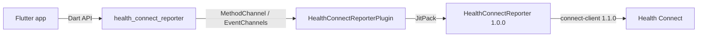

# health_connect_reporter — Architecture (arc42)

The architecture of the Flutter plugin `health_connect_reporter`, following the [arc42](https://arc42.org) template. Conventions and rules live in [AGENTS.md](../../AGENTS.md); decisions in [doc/adr/](../adr/).

## 1. Introduction and Goals

`health_connect_reporter` gives Flutter apps on Android access to Health Connect. It exposes the Kotlin library [HealthConnectReporter](https://github.com/kvs-coder/HealthConnectReporter) 1.0.0 to Dart as the static API `HealthConnectReporter`.

**Requirements**

| Area | Dart methods | State |
| :--- | :--- | :--- |
| Facade | `availability` | done |
| Manager | `requestPermissions`, `grantedPermissions`, `revokeAllPermissions`, `isFeatureAvailable`, `openSettings`, `openInstall` | planned |
| Reader | `read`, `readPage`, `readById`, `aggregate`, `aggregateGroups` | planned |
| Writer | `insert`, `update`, `delete`, `deleteByIds`, `deleteByRange` | planned |
| Observer | `anchor`, `changes`, `observe` (live subscription) | planned |

**Quality goals**

1. **Fidelity**: the plugin mirrors the library 1:1 — methods, types, JSON and errors.
2. **Testability**: every Dart method is tested against mocked channels, every Kotlin path against a mocked `HealthConnect`.
3. **Parity**: shapes and names match samsung_health_reporter wherever Health Connect allows it.

## 3. Context

## 5. Building Blocks

| Block | Where | Responsibility |
| :--- | :--- | :--- |
| `HealthConnectReporter` | `lib/health_connect_reporter.dart` | Static Dart API; Android check before any channel call. |
| Models | `lib/model/` | Plain Dart models parsed from the library's JSON. |
| `HealthConnectReporterPlugin` | `android/src/main/kotlin/…` | Channel setup, plugin-owned `MainScope`. |
| `HealthConnectDispatcher` | same | One `Method` case per Dart method; replies JSON, errors as `PlatformException`. |
| `HealthConnect` / `ReporterHealthConnect` | same | Library calls behind an interface, faked in unit tests. |

## 9. Decisions

| ADR | Decision |
| :--- | :--- |
| [0001](../adr/0001-health-connect-reporter-for-flutter.md) | A Flutter plugin of its own for Health Connect |
