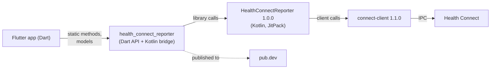
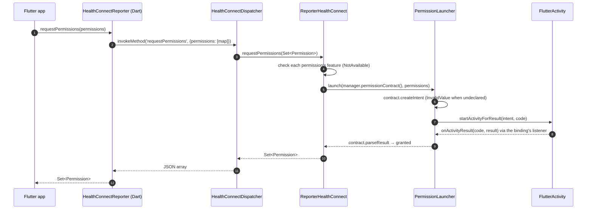
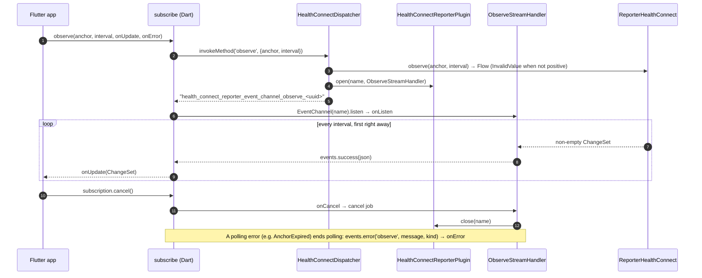
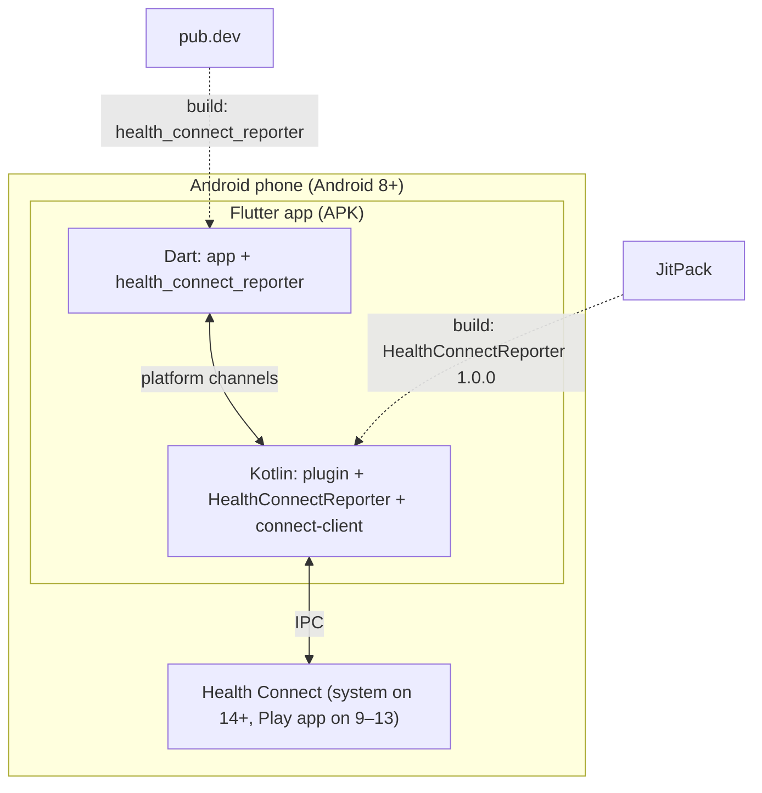

# health_connect_reporter — Architecture (arc42)

The architecture of the Flutter plugin `health_connect_reporter`, following the [arc42](https://arc42.org) template. Conventions and rules live in [AGENTS.md](../../AGENTS.md); decisions in [doc/adr/](../adr/).

## 1. Introduction and Goals

`health_connect_reporter` gives Flutter apps on Android access to Health Connect. It exposes the Kotlin library [HealthConnectReporter](https://github.com/kvs-coder/HealthConnectReporter) 1.0.0 to Dart as the static API `HealthConnectReporter`.

**Requirements**

| Area | Dart methods | State |
| :--- | :--- | :--- |
| Facade | `availability` | done |
| Manager | `requestPermissions`, `grantedPermissions`, `revokeAllPermissions`, `isFeatureAvailable`, `openSettings`, `openInstall` | done |
| Reader | `read`, `readPage`, `readById`, `aggregate`, `aggregateGroups` | done |
| Writer | `insert`, `update`, `delete`, `deleteByIds`, `deleteByRange` | done |
| Observer | `anchor`, `changes`, `observe` (live subscription) | done |

**Quality goals**

1. **Fidelity**: the plugin mirrors the library 1:1 — methods, types, JSON and errors.
2. **Testability**: every Dart method is tested against mocked channels, every Kotlin path against a mocked `HealthConnect`.
3. **Parity**: shapes and names match samsung_health_reporter wherever Health Connect allows it.

## 2. Architecture Constraints

| Constraint | Consequence |
| :--- | :--- |
| Health Connect is Android only | The plugin is Android only; elsewhere `availability` is `unavailable` and every other method throws `UnsupportedError` |
| connect-client 1.1.0 needs Android 8 | `minSdk = 26`; Health Connect is built into Android 14+ and an app from Google Play on Android 9–13 |
| HealthConnectReporter 1.0.0 from JitPack | The app adds `maven("https://jitpack.io")`; Java/JVM 17 |
| Flutter 3.44+ / Dart 3.5+ | SDK constraints in `pubspec.yaml` |
| Health Connect ignores undeclared permissions | The app declares every `android.permission.health.*` it requests, the rationale activity and the `VIEW_PERMISSION_USAGE` alias; the plugin's manifest adds nothing |
| `FlutterActivity` has no activity result registry | The permission screen starts with `startActivityForResult` ([ADR 0002](../adr/0002-permission-screen-on-the-plugin-activity.md)) |

## 3. System Scope and Context

| Neighbour | Interface |
| :--- | :--- |
| Flutter app | `HealthConnectReporter` static methods, models in `lib/model/`, `PlatformException` errors |
| HealthConnectReporter | Kotlin API (`manager`, `reader`, `writer`, `observer`), payloads with `json` and `make(from:)` |
| Health Connect / connect-client | Owned by the library; plugin Kotlin never imports `androidx.health.connect.client` |

## 4. Solution Strategy

- **Thin bridge over one library**: mapping records to payloads happens in HealthConnectReporter; the plugin only moves arguments and replies across the channel.
- **JSON as contract**: payloads cross as the library's `json`; Dart parses them into immutable models and sends their `map`s back, which Kotlin reads with `make(from:)` (sealed non-payloads like `Permission` and `TimeGroup` through kotlinx.serialization). Dart's nulls mean absent ([ADR 0003](../adr/0003-dart-nulls-mean-absent.md)).
- **One method channel, one event channel per subscription**: one-shot calls share `health_connect_reporter_method_channel`; each `observe` gets its own channel, so subscriptions never share polling.
- **Testing seam**: the dispatcher talks to the `HealthConnect` interface, which unit tests mock.

## 5. Building Block View

| Block | Where | Responsibility |
| :--- | :--- | :--- |
| `HealthConnectReporter` | `lib/health_connect_reporter.dart` | Static Dart API; Android check before any channel call. |
| Models | `lib/model/` | Plain Dart models parsed from the library's JSON: 41 payloads, 25 enums, sealed permissions, time groups, goals and targets. |
| `subscribe` | `lib/model/decorator/subscription.dart` | One event channel per `observe` subscription. |
| `HealthConnectReporterPlugin` | `android/src/main/kotlin/…` | Channel setup, plugin-owned `MainScope`, event channels, activity binding. |
| `HealthConnectDispatcher` | same | One `Method` case per Dart method; replies JSON, errors as `PlatformException`. |
| `HealthConnect` / `ReporterHealthConnect` | same | Library calls behind an interface, faked in unit tests, over one lazily connected `HealthConnectReporter`. |
| `PermissionLauncher` | same | The library's permission contract on the attached activity, resumed by the activity result listener. |
| `ObserveStreamHandler` | same | Collects one subscription's change sets while Dart listens. |
| `Extensions+Map` / `+Payload` / `+Permission` | same | Argument readers, JSON replies and error kinds, permission features. |

### Example app (`example/`)

A catalog of every method (BLoC on plain streams, no packages) and `integration_test/catalog_test.dart`, which runs every row on a phone. Its manifest is the reference setup: every health permission, the rationale activity and the usage alias.

## 6. Runtime View

### Permission screen: `requestPermissions`

### Live subscription: `observe` and cancel

## 7. Deployment View

**Delivery pipeline** (`.github/workflows/`): `ci.yml` (release guard, analyze, test + coverage ≥ 90 %, example test, Gradle build, Kotlin tests, ktlint) on every PR and push; `release.yml` keeps a release-please PR open and, once merged and tagged `vX.Y.Z`, starts `publish.yml`, which publishes to pub.dev through GitHub's OIDC token.

## 8. Crosscutting Concepts

- **JSON contract**: keys and value shapes follow the library exactly — timestamps epoch milliseconds, zone offsets seconds, one canonical unit per field, enums by Kotlin name or `@SerialName`, a sample's `type` = `HealthType.identifier`. Lists reply as JSON arrays; `readPage` replies `{"items":[...],"nextPageToken":"..."}`.
- **Identity**: `id` names the stored record, `clientRecordId` / `clientRecordVersion` the app's own key and version; update upserts by client record id first, else by id; update and delete send the sample's `map` with all three.
- **Errors**: every failure is a `PlatformException` — `code` the method name, `message` the library's message, `details` the kind as a `String`: `NotAuthorized`, `InvalidType`, `InvalidValue`, `NotAvailable`, `AnchorExpired` or `Platform`. Observe errors arrive on `onError` with code `observe`.
- **Threads**: calls run in the plugin's `MainScope`; results and events are delivered on the platform thread.
- **Connection**: `ReporterHealthConnect` creates the `HealthConnectReporter` on the first call that needs it and retries after a failure; `availability` and `openInstall` need none.
- **Platform guard**: `availability` is `unavailable` outside Android; every other method throws `UnsupportedError` before any channel call.
- **Parsing**: numbers through `parseInt` / `parseDouble` / `parseNum`; optional and later-added fields are nullable; unknown sample, permission, group, goal or target types throw `InvalidValueException`.
- **Testing**: fixtures are the JSON the library encodes for its own test fixtures (`test/fixtures.dart`, `android/src/test/.../Fixtures.kt`); Dart API tests against mocked channels; Kotlin dispatcher, launcher and stream handler tests against mocks (JUnit 5, MockK).

## 9. Architecture Decisions

| ADR | Decision |
| :--- | :--- |
| [0001](../adr/0001-health-connect-reporter-for-flutter.md) | A Flutter plugin of its own for Health Connect |
| [0002](../adr/0002-permission-screen-on-the-plugin-activity.md) | The permission screen runs on the plugin's activity through the activity result listener |
| [0003](../adr/0003-dart-nulls-mean-absent.md) | Dart's nulls in argument maps mean absent |

## 10. Quality Requirements

| Quality | Scenario | Measure |
| :--- | :--- | :--- |
| Fidelity | A library payload is read, sent back for update and deleted | Every fixture round-trips to the library's exact JSON in Dart, and every type's map is read back by `make(from:)` to the same JSON in Kotlin |
| Correctness | Every Dart method sends its arguments and parses its reply or error | API tests per method; Kotlin dispatcher tests per `Method` |
| Coverage | A change lowers test coverage of `lib/` | CI fails below 90 % line coverage |
| Isolation | Two subscriptions; one is cancelled | Separate event channels and coroutine jobs; the other keeps polling |
| Robustness | Health Connect is missing or lacks a feature | `availability` reports it; calls fail with `NotAvailable`, no crash |
| Style | Kotlin or Dart change | ktlint 1.8.0 and `flutter analyze` clean in CI |

## 11. Risks and Technical Debt

| Risk / debt | Impact | Mitigation |
| :--- | :--- | :--- |
| `openInstall` builds HealthConnectManager's Google Play intent itself, since the manager needs a connection that fails exactly when Health Connect must be installed | The intent can drift from the library's | Add a connection-free `installIntent(context)` to HealthConnectReporter and forward it |
| The permission screen can't be driven from a test | `requestPermissions` on a device is checked by hand; `PermissionLauncher` is unit-tested | Run the example's `requestPermissions` row before a release |
| Integration tests need a phone with Health Connect | `integration_test/catalog_test.dart` runs manually, not in CI | Run it before dispatcher changes (AGENTS.md §6D) |
| Dependency on a single library version from JitPack | JitPack outage or library changes break builds and the JSON contract | Pinned to 1.0.0; library changes are mirrored deliberately |

## 12. Glossary

| Term | Meaning |
| :--- | :--- |
| Health Connect | Android's on-device store for health and fitness data |
| HealthConnectReporter | The Kotlin library wrapping connect-client; the plugin's only native dependency |
| `HealthType` | A Health Connect record type, e.g. `HEART_RATE`; carries its `identifier`, `isWritable` and `feature` |
| `Feature` | A Health Connect capability older versions may lack, e.g. skin temperature or reading in the background |
| Sample / `WritableSample` | A stored record; every Health Connect record is writable |
| `id` / `clientRecordId` | Health Connect's id of a record / the app's own key for it, with `clientRecordVersion` |
| Aggregation | A summary Health Connect computes, e.g. `STEPS_COUNT_TOTAL`, optionally grouped by `TimeGroup` |
| `Anchor` / `ChangeSet` | A position in the change history / the upserts, deletions and next anchor since one |
| Observe subscription | A polled stream of `ChangeSet`s on its own event channel |
| Epoch milliseconds | The timestamp format of every time field |
